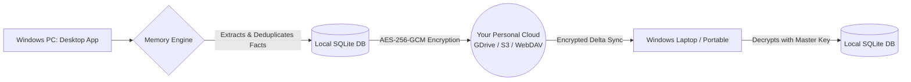

# 🧠 Cherry Studio Enhanced

**Your AI, Your Cloud, Your Memory — Everywhere.**

An open-source fork of [Cherry Studio](https://github.com/CherryHQ/cherry-studio) featuring **End-to-End Encrypted Personal Cloud Sync** and **Autonomous Long-Term Memory** across all your Windows devices and LLM providers.

[-0078D6.svg)](#installation)

---

## 💡 Why This Fork Exists

Using official web subscriptions (ChatGPT Plus, Claude Pro) gives you cloud sync and persistent memory, **but locks you into a single vendor and $20–$60/month fees**.

Switching to BYOK (Bring Your Own Key) desktop clients eliminates subscription lock-in, **but traps your chats, prompts, and context on one machine**. Every new conversation feels like talking to a stranger with amnesia.

**Cherry Studio Enhanced bridges this gap** — giving you multi-provider API freedom (AWS Bedrock, Google Gemini, Anthropic Claude, Ollama) paired with zero-knowledge sync via your own cloud storage and a unified personal memory engine.

---

## ✨ Key Features

### ☁️ Personal Cloud Sync (Zero-Knowledge)
Keep your workspace identical across your home PC, work laptop, and portable USB drives without trusting third-party servers.
*   **Bring Your Own Cloud (BYOC):** Native support for **Google Drive**, **S3-compatible storage** (AWS S3, Cloudflare R2, MinIO), and **WebDAV** (Nextcloud, Yandex Disk, OwnCloud).
*   **End-to-End Encryption (E2EE):** All chat histories, API keys, custom assistants, and memory nodes are encrypted locally with **AES-256-GCM** using your master passphrase before leaving your device.
*   **Delta Sync & Conflict Resolution:** Fast background synchronization that merges offline edits cleanly and flags conflicts only when the exact same item was modified simultaneously.

### 🧠 Unified Long-Term Personal Memory
Stop repeating your tech stack, writing style, preferences, or active projects in every new chat.
*   **Autonomous Fact Extraction:** A lightweight background agent extracts key facts, preferences, and ongoing goals from your conversations using any fast/low-cost model of your choice (e.g., Gemini Flash, Claude Haiku, or local Ollama).
*   **Cross-Model Context:** Start a project with **Claude**, brainstorm with **Gemini**, and debug with **AWS Bedrock** — all models share the same evolving memory profile about you.
*   **Memory Vault UI:** Full transparency and control — inspect, edit, pin, search, or delete any stored memory node at any time.

### 🚀 Full Upstream Power Included
Inherits everything from [Cherry Studio](https://github.com/CherryHQ/cherry-studio):
*   **Multi-Provider Support:** Anthropic, Google (AI Studio & Vertex AI), AWS Bedrock, OpenAI, OpenRouter, and local models via Ollama / LM Studio.
*   **MCP (Model Context Protocol):** Connect local tools, file systems, and databases out of the box.
*   **Local RAG & Artifacts:** Chat with your documents and preview generated code and diagrams live.

---

## 📊 Comparison

| Feature | Official Web UIs (ChatGPT/Claude) | Upstream Cherry Studio | **Cherry Studio Enhanced** |
| :--- | :---: | :---: | :---: |
| **Pricing Model** | Fixed $20+/mo per provider | Pay-as-you-go (API) | **Pay-as-you-go (API)** |
| **Multi-Model (Bedrock, Gemini, Claude)** | ❌ Single vendor | ✅ Yes | ✅ **Yes** |
| **Cross-Device Sync** | ✅ Proprietary cloud | ❌ Manual export/import | ✅ **E2E Sync via Your Cloud** |
| **Long-Term Personal Memory** | ✅ Vendor-locked | ❌ None | ✅ **Unified across all LLMs** |
| **Zero-Knowledge Privacy** | ❌ Provider reads data | ⚠️ Local only | ✅ **Client-side AES-256-GCM** |

---

## ⚡ Quick Setup

1. **Add Your API Keys:** Go to `Settings → Model Providers` and add your keys for Anthropic, Google, AWS Bedrock, or connect a local Ollama instance.
2. **Enable Cloud Sync:** Open `Settings → Cloud Sync`, choose **Google Drive**, **S3**, or **WebDAV**, and set a strong **Master Passphrase** (used to derive your local encryption key — never stored in the cloud).
3. **Configure Memory Engine:** Open `Settings → Personal Memory`, toggle on **Auto-Extract Facts**, and select a lightweight model (e.g., `gemini-2.5-flash` or `claude-3-5-haiku`) for zero-overhead background extraction.

---

## 🔒 Architecture & Privacy

Your data never touches our servers — **because we don't have any.**

*   **Local-First:** The app works 100% offline. Cloud sync runs asynchronously in the background.
*   **Zero-Knowledge:** Your cloud provider only sees encrypted binary chunks. Neither cloud hosts nor the developers of this project can read your chats or decrypt your API keys.

---

## 📦 Installation

### Download for Windows (Recommended)
Currently, pre-built releases are available for **Windows 10 / 11 (64-bit)** on the [Releases](https://github.com/cratergrousedirect/cherry-studio-enchanced/releases/tag/v0.2.4) page:

*   **Standard Installer:** `Cherry-Studio-Enhanced-0.2.4-win-x64-setup.exe` — Installs the app to your system with Start Menu shortcuts and auto-update support.
*   **Portable Version:** `Cherry-Studio-Enhanced-0.2.4-win-x64-portable.exe` — Zero-installation single executable. Ideal for USB drives or restricted work machines without admin rights.

> **Note on Windows SmartScreen:** Since this is an independent open-source fork without a commercial code-signing certificate, Windows Defender SmartScreen may show a warning on first launch. Click **"More info" → "Run anyway"** to proceed.

---

## 🗺️ Roadmap

- [x] Fork setup & automated upstream rebase pipeline
- [x] **v0.1 — Encrypted Cloud Sync Engine:** Google Drive, S3 & WebDAV adapters with AES-256-GCM encryption
- [x] **v0.2 — Personal Memory Vault:** Automated background fact extraction, deduplication & Memory Vault UI
- [ ] **v0.3 — Smart Context Injection:** Local embedding retrieval of only relevant memories per prompt (reduces token usage)
- [ ] **v0.4 — Cross-Platform Builds & More Clouds:** Official macOS / Linux releases + iCloud Drive & Dropbox OAuth support
- [ ] **v1.0 — Mobile Companion Sync:** Seamless sync compatibility with Cherry Studio Mobile

---

## 📜 Acknowledgments & License

*   **Upstream Project:** Huge thanks to the [CherryHQ](https://github.com/CherryHQ/cherry-studio) team for building an incredible open-source AI desktop foundation.
*   **License:** Distributed under the **GNU Affero General Public License v3.0 (AGPL-3.0)**. See `LICENSE` for details.
